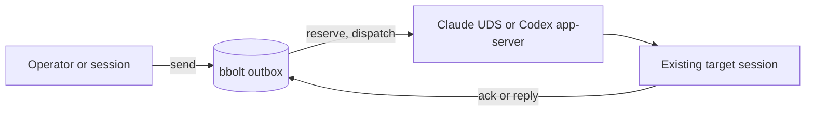

# amgo

Native session messaging for existing Claude Code and Codex sessions.

[](https://github.com/xiaolai/amgo/actions/workflows/ci.yml)

`amgo` is a standalone Go CLI. It does not start an agent, daemon, MCP server or
model SDK. It discovers sessions that are already running, sends one bounded
message through the provider's own local transport, and keeps a durable outbox
with explicit acknowledgement rules.

**v0.1.0** supports Claude Code and Codex on macOS and Linux. Supervised jobs
and the other adapters are later milestones.

## Why

- **Submitted is not delivered.** A Claude send is recorded as `submitted` when
  the native inbox socket accepts the frame. Only an explicit recipient
  acknowledgement counts as delivery evidence.
- **Unknown stays unknown.** If a write may have reached the provider but no
  response came back, the attempt is `unknown` and is never retried
  automatically.
- **No idle daemon.** State is a local bbolt database opened for the length of a
  command. No amgo process survives a bounded command or wait.
- **The provider remains the authority.** Native holds, refusals and permission
  rules are not bypassed or second-guessed.

## Install

```sh
brew install xiaolai/tap/amgo
```

Or build from source with Go 1.26+:

```sh
CGO_ENABLED=0 go build -trimpath -o dist/amgo ./cmd/amgo
./dist/amgo version
```

Release archives for darwin/arm64, darwin/amd64, linux/arm64 and linux/amd64,
plus `SHA256SUMS`, are attached to each
[GitHub release](https://github.com/xiaolai/amgo/releases). macOS binaries are
signed with a Developer ID and notarised by Apple.

## Quick start

Claude Code:

```sh
amgo sessions --discover --config-home "${CLAUDE_CONFIG_DIR:-$HOME/.claude}"
amgo join claude --name architect --session <native-session-id> \
  --config-home "${CLAUDE_CONFIG_DIR:-$HOME/.claude}"

printf '%s' 'Review the parser change.' | \
  amgo send architect --stdin --accept-unknown-delivery --expect-reply

amgo wait <message-id> --until acknowledged --timeout 60s
```

`--accept-unknown-delivery` is required once per Claude target: an external
sender cannot observe native holds or refusals. The acknowledgement is
persisted for later sends to the same target.

Codex:

```sh
amgo sessions --discover --codex-home "${CODEX_HOME:-$HOME/.codex}"
amgo join codex --name builder --thread <thread-id> --codex-home "${CODEX_HOME:-$HOME/.codex}"

printf '%s' 'Run the focused tests.' | amgo send builder --stdin
```

Only threads already loaded in the shared Codex app-server are messageable.
Sending to an idle thread starts a turn and can spend tokens.

Replies and acknowledgements:

```sh
printf '%s' 'Done; the tests pass.' | \
  amgo reply <message-id> --stdin --as <your-alias>
amgo ack <message-id> --as <your-alias>
amgo inbox
amgo read <message-id>
```

## Requirements

- Claude Code 2.1.248+ for Claude messaging.
- Codex 0.163.x for Codex messaging; other minor releases fail closed.
- macOS or Linux. Windows is not supported in v0.1.
- The same OS user as the target session. That user boundary is the trust
  boundary; amgo is not an authorization or sandbox boundary.
- Go 1.26+ only when building from source.

## Commands

| Command | Purpose |
|---|---|
| `version` | Build version and JSON schema version |
| `doctor` | Capability probes and read-only state invariants; `--probe` costs one model turn |
| `adapters` | Adapter capability matrix |
| `sessions` | Registered sessions; `--discover` adds live native candidates |
| `join`, `leave` | Register or remove a target alias |
| `send` | Send a message to a registered target |
| `reply` | Reply to a message; a reply is also an acknowledgement |
| `inbox`, `read` | Local message list and full record |
| `ack` | Explicit acknowledgement with provenance |
| `wait` | Bounded wait for acknowledgement or reply |
| `conversation` | Create, show or close a named budget |
| `export`, `prune` | JSONL export and explicit retention |
| `recover` | Reconcile dead attempts and import the outcome journal |

Run `amgo <command> --help` for flags. Commands support `--json` with a
versioned envelope and stable exit codes; `export` always writes JSONL.

## How it works



The outbox persists intent, budget and an idempotency binding before any native
I/O, then closes the database during transport. The outcome is recorded in a
short transaction; a write failure after native acceptance is reported as
`outcome_unpersisted`, not as a retry-safe error.

See the [quickstart](docs/quickstart.md) for the full command flow and
[security notes](docs/security.md) for the trust model.

## Status

| Area | v0.1.0 |
|---|---|
| One CGO-free Go binary | implemented |
| Versioned JSON envelope and stable exit codes | implemented |
| bbolt state with short transactions, reservations and counters | implemented |
| Explicit join/leave and metadata-only discovery | implemented |
| Claude UDS send, peer-key handling, session-ID guard | implemented; native gates passing |
| Codex WebSocket discovery and queue send | implemented; native gates passing |
| Idempotency, budgets, reply/ack/wait, recovery, export, prune | implemented |
| Doctor and read-only state invariants | implemented |
| Jobs, OpenCode, Qwen, agy live messaging | later milestones |
| Linux native certification and Windows | not claimed |

## Limits

- A Claude send is `submitted` when the native inbox socket accepts the frame.
  Holds, refusals and rate-limit drops are not observable to an external sender.
  The recipient must acknowledge explicitly.
- The Codex app-server WebSocket and `thread/queue/add` are experimental. The
  adapter is pinned to the tested minor release and fails closed otherwise.
- The Codex loaded-target guard is best-effort; a loaded, unloaded and reloaded
  cycle between checks is invisible.
- A send to an idle Codex thread starts a turn and can spend tokens.
- No amgo process survives a bounded command. There is no always-on daemon.
- State is local and owner-only (0700/0600). It is not encrypted at rest; the
  same-user boundary applies.

## Development

```sh
go test ./...
go test -race ./...
go vet ./...
make secrets                      # publication-set and history secret scan
AMGO_CONTENTION=1 go test ./internal/store -run TestContentionMultiProcess -count=1
```

The native delivery gates are opt-in. They launch disposable Claude and Codex
sessions in private homes, never a personal session, and may spend model
tokens:

```sh
AMGO_NATIVE=1 make native
```

See `tests/native/README.md` for the gate matrix and the manual remainder.

## License

ISC. See [LICENSE](LICENSE).

amgo is not affiliated with Anthropic or OpenAI. Claude Code and Codex are
products of their respective owners.
