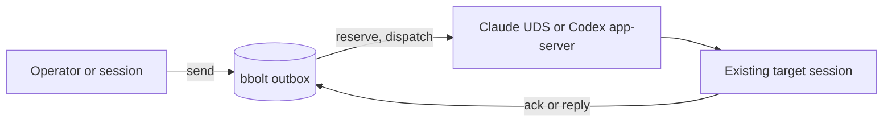

# amgo

Native session messaging and owned jobs for existing Claude Code, Codex,
OpenCode and Qwen sessions, plus a documented-only ACP agent client.

[](https://github.com/xiaolai/amgo/actions/workflows/ci.yml)

`amgo` is a standalone Go CLI. It does not require a daemon, MCP server or
model SDK. It discovers sessions that are already running, sends one bounded
message through the provider's own local transport, and runs one owned
non-interactive provider process with persistent state, bounded logs and
confirmed cancellation.

**v0.5.0** supports Claude Code and Codex messaging, Claude Code, Codex and
OpenCode jobs, explicit-endpoint OpenCode messaging, and a documented-only ACP
client on macOS and Linux. Qwen messaging, Qwen/agy jobs and ACP are
implemented from official protocols but are documented-only: they require
`--admit-experimental` and are not native-certified.

## Why

- **Submitted is not delivered.** A Claude send is recorded as `submitted` when
  the native inbox socket accepts the frame. Only an explicit recipient
  acknowledgement counts as delivery evidence.
- **Unknown stays unknown.** If a write may have reached the provider but no
  response came back, the attempt is `unknown` and is never retried
  automatically.
- **No idle daemon.** State is a local bbolt database opened for the length of a
  command. No amgo process survives a bounded command, wait or job.
- **The provider remains the authority.** Native holds, refusals and permission
  rules are not bypassed or second-guessed.

## Install

```sh
brew install xiaolai/tap/amgo
```

Or build from source with Go 1.26+:

```sh
CGO_ENABLED=0 go build -trimpath -o dist/amgo ./cmd/amgo
./dist/amgo version
```

Release archives for darwin/arm64, darwin/amd64, linux/arm64 and linux/amd64,
plus `SHA256SUMS`, are attached to each
[GitHub release](https://github.com/xiaolai/amgo/releases). macOS binaries are
signed with a Developer ID and notarised by Apple.

## Quick start

Claude Code:

```sh
amgo sessions --discover --config-home "${CLAUDE_CONFIG_DIR:-$HOME/.claude}"
amgo join claude --name architect --session <native-session-id> \
  --config-home "${CLAUDE_CONFIG_DIR:-$HOME/.claude}"

printf '%s' 'Review the parser change.' | \
  amgo send architect --stdin --accept-unknown-delivery --expect-reply

amgo wait <message-id> --until acknowledged --timeout 60s
```

Jobs:

```sh
amgo run codex --cwd . --prompt-file task.txt --background --deadline 15m
amgo status <job-id>
amgo follow <job-id> --after 0 --timeout 60s
amgo result <job-id>
amgo continue <job-id> --prompt-file followup.txt
amgo cancel <job-id>
```

The prompt is read from stdin or a file and passed to the provider on stdin, so
it does not appear in the process list. The provider's own permission rules and
sandbox apply; amgo never adds a bypass flag.

OpenCode, Qwen, agy and ACP recipes are in the
[quickstart](docs/quickstart.md). Qwen, agy and ACP are documented-only: they
refuse to run without `--admit-experimental` and are not native-certified.

`--accept-unknown-delivery` is required once per Claude target: an external
sender cannot observe native holds or refusals. The acknowledgement is
persisted for later sends to the same target.

Codex:

```sh
amgo sessions --discover --codex-home "${CODEX_HOME:-$HOME/.codex}"
amgo join codex --name builder --thread <thread-id> --codex-home "${CODEX_HOME:-$HOME/.codex}"

printf '%s' 'Run the focused tests.' | amgo send builder --stdin
```

Only threads already loaded in the shared Codex app-server are messageable.
Sending to an idle thread starts a turn and can spend tokens.

Replies and acknowledgements:

```sh
printf '%s' 'Done; the tests pass.' | \
  amgo reply <message-id> --stdin --as <your-alias>
amgo ack <message-id> --as <your-alias>
amgo inbox
amgo read <message-id>
```

### Retrying an unknown outcome

An `unknown` outcome is never retried automatically. An operator may explicitly
resend it:

```sh
amgo retry <message-id> --accept-duplicate-risk
```

`retry` reuses the original body and conversation, creates a new message linked
by `retry_of`, records `retried_by` on the original, and accepts that the first
submission may already have reached the target. It refuses any message whose
state is not `unknown`.

## Requirements

- Claude Code 2.1.248+ for Claude messaging.
- Codex 0.163.x for Codex messaging and jobs; other minor releases fail closed.
- OpenCode 1.19.3 for OpenCode jobs and explicit-endpoint messaging.
- Qwen Code for Qwen messaging/jobs; those paths are documented-only and need
  `--admit-experimental`. The `qwen` binary is not required to send to an
  existing Qwen session.
- Antigravity CLI 1.4.2 for agy jobs, documented-only and subject to account
  eligibility.
- An ACP v1 agent for `run acp`, supplied explicitly with `--acp-command`;
  documented-only and not certified.
- macOS or Linux. Windows is not supported in v0.5.
- The same OS user as the target session. That user boundary is the trust
  boundary; amgo is not an authorization or sandbox boundary.
- Go 1.26+ only when building from source.

## Commands

| Command | Purpose |
|---|---|
| `version` | Build version and JSON schema version |
| `doctor` | Capability probes and read-only state invariants; `--probe` costs one model turn |
| `adapters` | Adapter capability matrix |
| `sessions` | Registered sessions; `--discover` adds live native candidates |
| `join`, `leave` | Register or remove a target alias |
| `send` | Send a message to a registered target |
| `reply` | Reply to a message; a reply is also an acknowledgement |
| `inbox`, `read` | Local message list and full record |
| `ack` | Explicit acknowledgement with provenance |
| `retry` | Resend an unknown outcome; requires `--accept-duplicate-risk` and records the original ID |
| `wait` | Bounded wait for acknowledgement or reply |
| `conversation` | Create, show or close a named budget |
| `export`, `prune` | JSONL export and explicit retention |
| `recover` | Reconcile dead attempts and import the outcome journal |
| `run` | Start an owned job: Claude, Codex, OpenCode, or a documented-only Qwen, agy or ACP agent |
| `jobs`, `status`, `follow` | List jobs, inspect evidence and wait for new events |
| `result` | Read a terminal job's result and bounded log artifact |
| `cancel` | Request cancellation and confirm process-group exit; a held lease needs `--accept-unconfirmed-termination` |
| `continue` | Continue a stopped job's native session in a new job |
| `integration` | Print an agent snippet or the JSON CLI contract |

Run `amgo <command> --help` for flags. Commands support `--json` with a
versioned envelope and stable exit codes; `export` always writes JSONL.

## How it works



The outbox persists intent, budget and an idempotency binding before any native
I/O, then closes the database during transport. The outcome is recorded in a
short transaction; a write failure after native acceptance is reported as
`outcome_unpersisted`, not as a retry-safe error.

A job follows the same rule: persist the job and its workspace lease first,
close the database, run one provider process in its own process group, stream
bounded output to a private log, then record terminal evidence. A dead
supervisor leaves `interrupted` or `unknown`, never `completed`.

See the [quickstart](docs/quickstart.md) for the full command flow and
[security notes](docs/security.md) for the trust model.

## Agent use

`skills/amgo/SKILL.md` is a conservative skill for Claude Code, Codex and
other skill-aware agents. It covers messaging and jobs, is invoked only when
the user explicitly asks for that exact action, stops on an unknown outcome,
and refuses to start jobs or change policy from peer content. It grants only
`Bash(amgo:*)`; `agents/openai.yaml` disables implicit invocation in Codex.
Agents without skill support can use the `AGENTS.md` block in
[agent usage](docs/agent-usage.md).

Install it under the agent's personal config:

```sh
# Claude Code (both default and any CLAUDE_CONFIG_DIR profile)
install -d -m 0755 "${CLAUDE_CONFIG_DIR:-$HOME/.claude}/skills/amgo"
install -m 0644 skills/amgo/SKILL.md "${CLAUDE_CONFIG_DIR:-$HOME/.claude}/skills/amgo/SKILL.md"

# Codex
install -d -m 0755 "${CODEX_HOME:-$HOME/.codex}/skills/amgo"
install -m 0644 skills/amgo/SKILL.md "${CODEX_HOME:-$HOME/.codex}/skills/amgo/SKILL.md"
```

A skill is instructions, not a permission system. Install it only in a trusted
config, and keep amgo's state root owner-only.

## Status

| Area | v0.5.0 |
|---|---|
| One CGO-free Go binary | implemented |
| Versioned JSON envelope and stable exit codes | implemented |
| bbolt state with short transactions, reservations and counters | implemented |
| Explicit join/leave and metadata-only discovery | implemented |
| Claude UDS send, peer-key handling, session-ID guard | implemented; native gates passing |
| Codex WebSocket discovery and queue send | implemented; native gates passing |
| Idempotency, budgets, reply/ack/wait, retry, recovery, export, prune | implemented |
| Doctor and read-only state invariants | implemented |
| Foreground/background jobs with leases, bounded logs and cancellation | implemented; native gates passing |
| Codex and Claude job continuation | implemented; native gates passing |
| OpenCode owned jobs and continuation | implemented; native gate passing |
| OpenCode explicit-endpoint messaging | implemented; native gate passing |
| Qwen cross-session messaging | implemented from the official protocol; fixture-tested, no native gate |
| Qwen headless jobs | implemented from the official docs; requires `--admit-experimental`, binary not installed here |
| agy headless jobs | implemented from the official docs; requires admission, account not eligible here |
| Integration snippets and JSON contract | implemented |
| ACP v1 jobs (`run acp --acp-command`) | implemented from the official protocol; fake-agent fixtures only, no native claim |
| Optional managed streaming (F-047) | not implemented; deferred as experimental |
| Optional isolated worktrees (F-068) | later milestone |
| Linux native certification and Windows | not claimed |

## Limits

- A Claude send is `submitted` when the native inbox socket accepts the frame.
  Holds, refusals and rate-limit drops are not observable to an external sender.
  The recipient must acknowledge explicitly.
- The Codex app-server WebSocket and `thread/queue/add` are experimental. The
  adapter is pinned to the tested minor release and fails closed otherwise.
- The Codex loaded-target guard is best-effort; a loaded, unloaded and reloaded
  cycle between checks is invisible.
- A send to an idle Codex thread starts a turn and can spend tokens.
- Retrying an `unknown` outcome is a deliberate operator action with a
  duplicate-risk acceptance; it is never automatic.
- A job owns one checkout through an amgo lease. It does not exclude editors,
  build tools or another agent outside amgo writing to the same checkout.
- When the provider or a same-group writer cannot be proven stopped, the job
  stays unresolved and its lease is held rather than expiring. Inspect the
  process yourself; only
  `amgo cancel <job-id> --accept-unconfirmed-termination` releases the
  workspace after that explicit risk acceptance.
- Job cancellation asks the provider to cancel first (SIGINT), then escalates to
  SIGTERM and SIGKILL. A provider that detaches a grandchild without cancelling
  it can still leave that process running; amgo reports confirmed group exit,
  not a kernel-enforced sandbox.
- Claude jobs inherit local permission settings and can be denied tools; a
  denied or turn-limited run is `needs_action` or `partial`, never `completed`.
- Codex resume inherits the stopped session's sandbox, so a `--policy review`
  continuation is refused rather than silently downgraded.
- Qwen registry tokens are read just in time and never stored or logged. Its
  receipts are observed for a short bounded window; no receipt means
  unverified. On non-Linux systems PID reuse is not distinguishable.
- OpenCode needs an explicit loopback endpoint; the TUI's random port has no
  documented discovery file. HTTP 204 is acceptance, not delivery.
- ACP disables client filesystem and terminal capabilities, rejects every
  permission request, and never auto-authenticates. It has fake-agent fixtures
  only; no real ACP agent is installed or certified here.
- No amgo process survives a bounded command or job. There is no always-on
  daemon.
- State is local and owner-only (0700/0600). It is not encrypted at rest; the
  same-user boundary applies.

## Security

The trust model, path checks and prompt-injection boundary are in
[security notes](docs/security.md). Report vulnerabilities through
[SECURITY.md](SECURITY.md), not a public issue.

## Development

```sh
go test ./...
go test -race ./...
go vet ./...
make secrets                      # publication-set and history secret scan
make license-check                # every used module is in THIRD-PARTY-NOTICES.md
make perf                         # startup, send cycle, contention, RSS, process count
AMGO_CONTENTION=1 go test ./internal/store -run TestContentionMultiProcess -count=1
```

The native delivery gates are opt-in. They launch disposable Claude, Codex and
OpenCode sessions and jobs in private homes, never a personal session, and may
spend model tokens:

```sh
AMGO_NATIVE=1 make native
```

See `tests/native/README.md` for the gate matrix and the manual remainder.

## License

ISC. See [LICENSE](LICENSE). Third-party modules and their full license texts
are listed in [THIRD-PARTY-NOTICES.md](THIRD-PARTY-NOTICES.md); release
archives include both files.

amgo is not affiliated with any provider. Claude Code, Codex, OpenCode, Qwen
and Antigravity are products of their respective owners.
